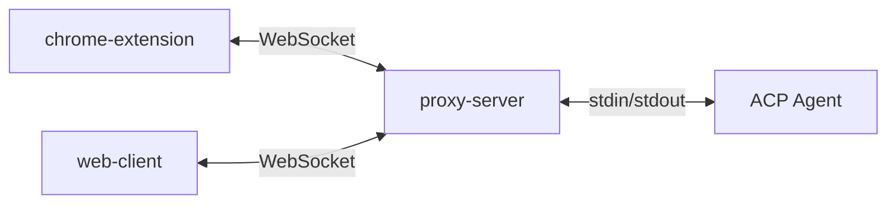

# AGENTS.md

## Architecture

Chrome ACP is a pnpm monorepo with 4 application packages and a documentation site:

- **chrome-extension** - Chrome MV3 extension with sidepanel UI
- **web-client** - Web client served by proxy-server
- **shared** - Shared UI components and utilities
- **proxy-server** - WebSocket server that bridges clients to ACP agents
- **docs** - Rspress documentation site



**Why proxy-server?**
Chrome extensions run in a browser sandbox and cannot spawn subprocesses. The proxy-server acts as a local bridge, spawning the ACP agent subprocess and relaying communication via WebSocket.

## Tech Stack

- **pnpm** - Package manager and workspace command runner
- **Vite 8** - Builds both frontends; Node.js runs build scripts and the proxy server (including Android Termux)
- **TypeScript (`tsc`)** - Builds the proxy server
- **React + TypeScript + Tailwind CSS**
- **[shadcn/ui](https://ui.shadcn.com/)** - Base UI component library
- **[Vercel AI Elements](https://elements.ai-sdk.dev/)** - AI chat components (Conversation, Message, CodeBlock, Reasoning, etc.)
- **Hono** - HTTP/WebSocket server framework for proxy-server

### Best Practices

- Use the pnpm version pinned in `package.json`. Add package dependencies with `pnpm --filter <package-name> add`; use `pnpm add -Dw` for root development tools. Never edit dependency declarations manually.
- Keep UI code DRY. Shared components go in `packages/shared` and are imported by other packages.
- Use Node.js APIs so the proxy server runs on Android Termux.
- Prefer [shadcn/ui](https://ui.shadcn.com/) and [Vercel AI Elements](https://elements.ai-sdk.dev/) for UI components. Use their CLIs with pnpm:
  ```bash
  pnpm dlx shadcn@latest add <component>
  pnpm dlx ai-elements@latest add <component>
  ```

## pnpm Workspace

The root `pnpm-workspace.yaml` includes `packages/*` and `docs`. All projects use the root `pnpm-lock.yaml`. Keep internal dependencies on `workspace:*` so they resolve locally.

Keep dependencies declared in the package that imports them. Dependency build
scripts are reviewed individually in `allowBuilds` in `pnpm-workspace.yaml`.

**All commands run from the root directory:**

```bash
# Use Node.js 26 from .nvmrc
nvm use

# Install dependencies
pnpm install

# Build all packages
pnpm run build

# Build individual packages
pnpm run build:extension
pnpm run build:proxy
pnpm run build:web
pnpm run build:docs

# Development mode
pnpm run dev
```

Packages reference each other via the `@chrome-acp/*` namespace:
```json
{
  "dependencies": {
    "@chrome-acp/shared": "workspace:*"
  }
}
```

## Build & Release

```bash
# Build all packages
pnpm run build

# Release a new version (updates manifest.json + package.json, tags, and pushes)
just release <version>
# Example: just release 1.0.30
```

After release, GitHub Actions automatically builds and uploads release artifacts.

Use `pnpm run build` for release artifacts: it builds the Web client before the
proxy package that ships its generated assets. Build documentation separately
with `pnpm run build:docs`.
